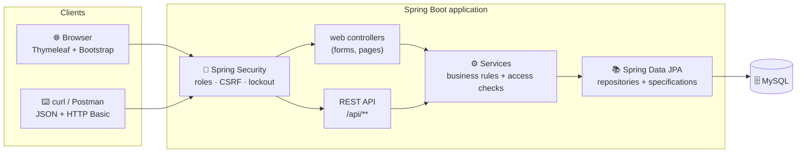
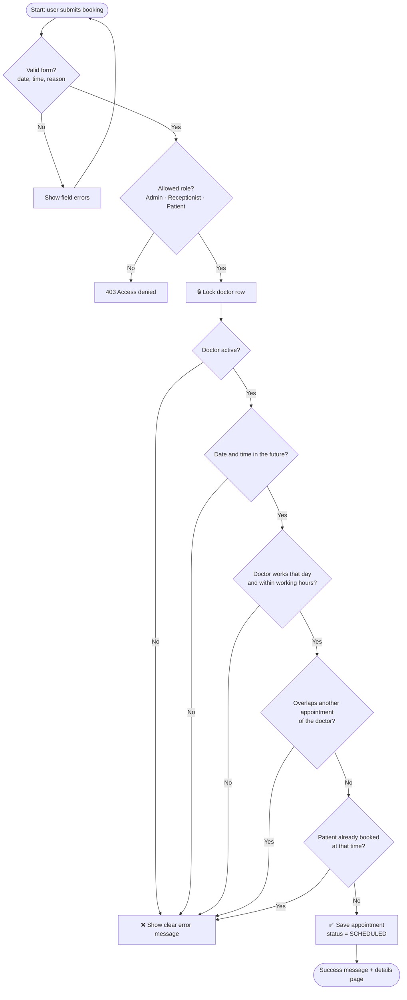
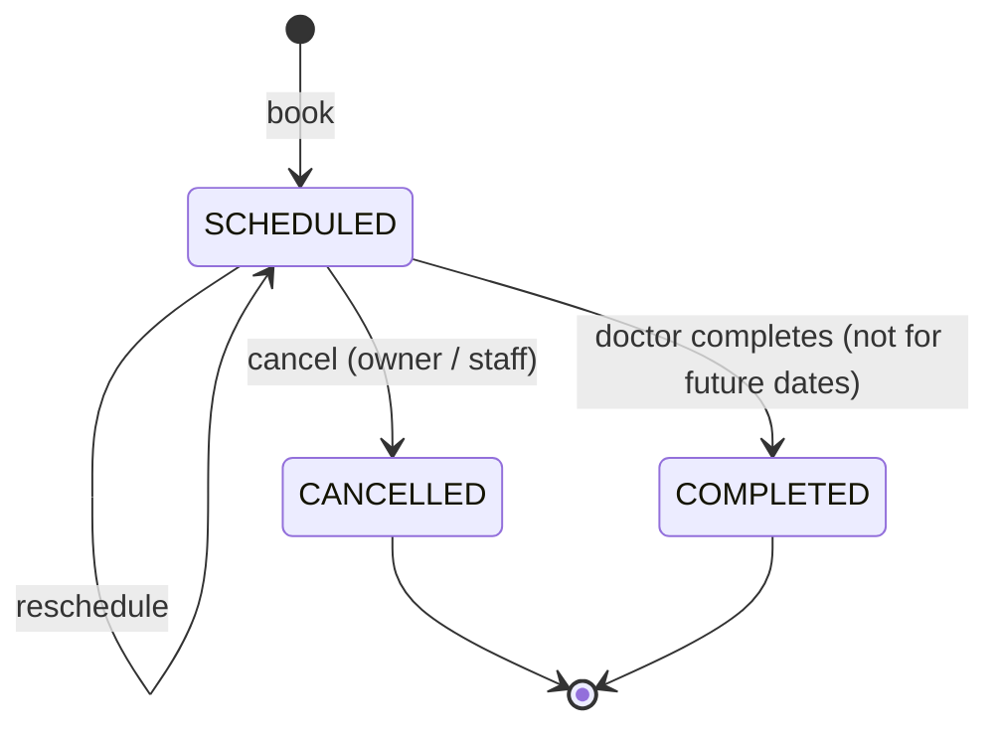
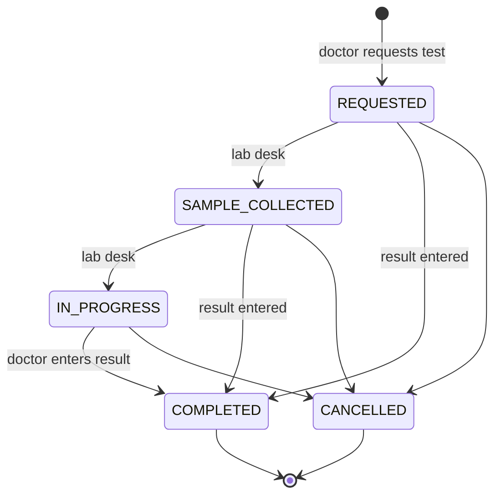
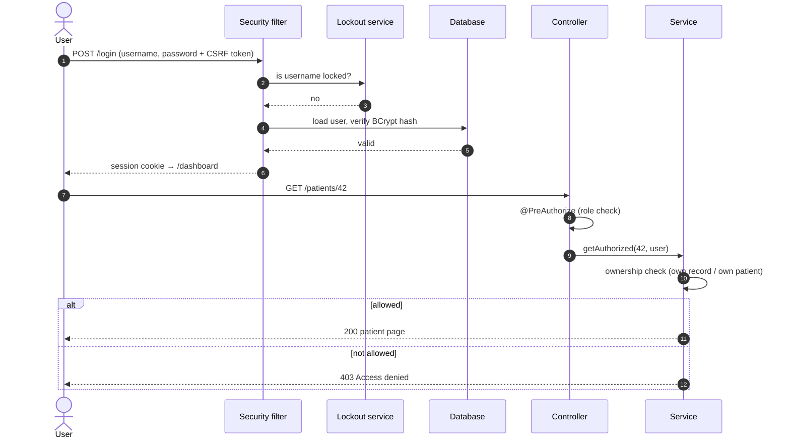
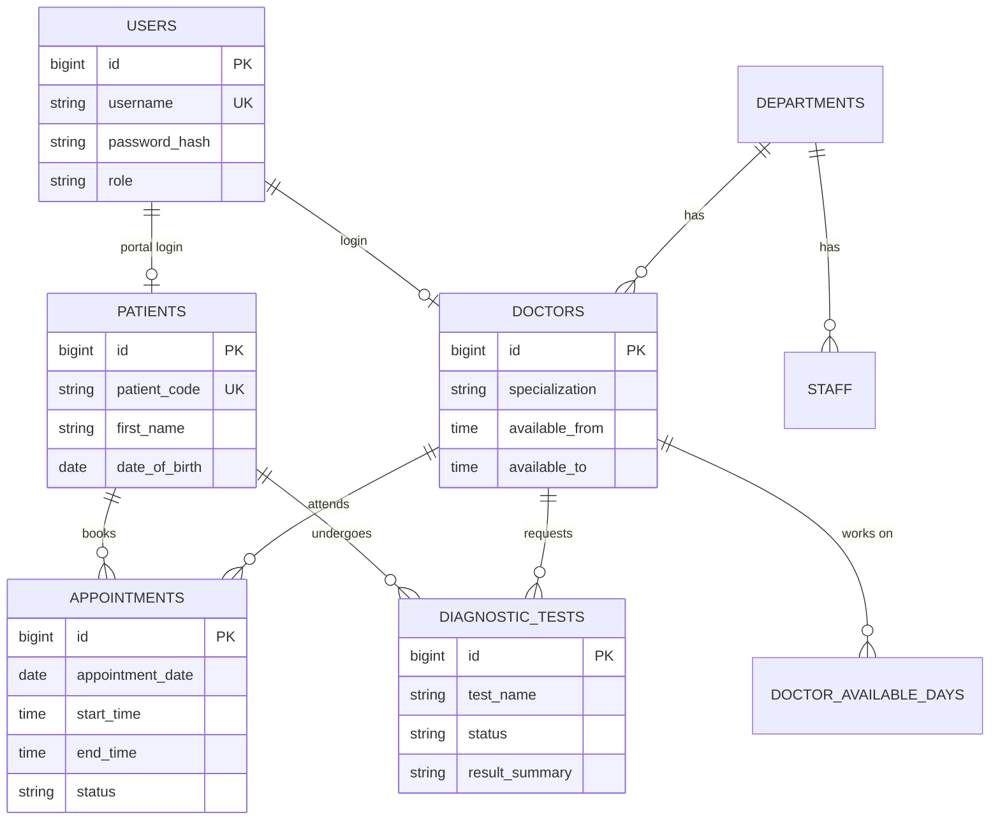
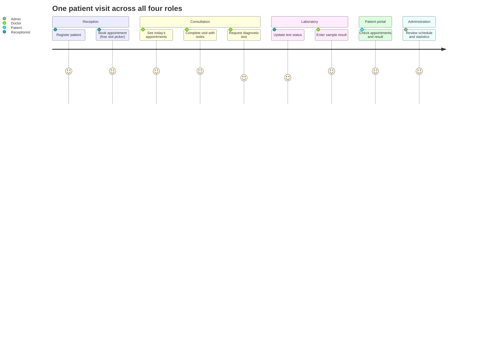

# Smart-Healthcare-Management-system
AI-powered Smart Healthcare Management System built using Java, Spring Boot, MySQL, and REST APIs to manage patients, doctors, appointments, and hospital operations.

<p align="center">
  
</p>

<p align="center">
  
  
  
  
  
</p>
<p align="center">
  
  
  
  
  
</p>

<h3 align="center">One secure platform for patient records, appointments, diagnostics and hospital administration.</h3>

<p align="center">
  <a href="#-quick-start">Quick start</a> ·
  <a href="#-feature-tour">Features</a> ·
  <a href="#-how-it-works">Flowcharts</a> ·
  <a href="#-rest-api">API</a> ·
  <a href="#-security">Security</a> ·
  <a href="#-testing">Tests</a> ·
  <a href="#-roadmap">Roadmap</a>
</p>

> ⚠️ **Educational project.** All names, phone numbers, e-mails and medical records in the demo data are **fictional**.
> Never store real patient information in it and never deploy it with demo data enabled.

---

## 📑 Table of contents

1. [Why this project](#-why-this-project) · 2. [Feature tour](#-feature-tour) · 3. [UI preview](#-ui-preview) ·
4. [How it works](#-how-it-works) · 5. [Quick start](#-quick-start) · 6. [REST API](#-rest-api) ·
7. [Security](#-security) · 8. [Testing](#-testing) · 9. [Project structure](#-project-structure) ·
10. [Troubleshooting](#-troubleshooting) · 11. [Roadmap](#-roadmap) · 12. [FAQ](#-faq)

---

## 🎯 Why this project

Hospitals juggle paper files, phone calls and spreadsheets. This system puts **four roles** on one platform:
receptionists register patients and book visits, doctors see their day and order tests, patients manage their own
appointments, and administrators run departments, staff and schedules — all with strict access control so
**patient data is only visible to the people who need it**.

## ✨ Feature tour

<table>
<tr>
<td width="50%" valign="top">

### 🔐 Authentication & roles
- Secure login / logout (BCrypt)
- Admin · Doctor · Receptionist · Patient
- Patient self-registration (can be switched off)
- Brute-force protection: 5 failures → 15 min lock
- Admin can disable accounts and reset passwords

### 🧑‍⚕️ Patient management
- Register, edit, view, delete (guarded)
- Search by name, ID, phone or e-mail + pagination
- Auto-generated patient code (`PAT-000001`)
- Optional patient-portal login at registration

### 👨‍⚕️ Doctor management
- Profiles with department, specialization, fee
- Working **days and hours** (availability)
- Active / inactive switch
- Filter by department or search by name

</td>
<td width="50%" valign="top">

### 📅 Appointment engine
- Book · reschedule · cancel · complete (with notes)
- **Live free-slot picker** (loads slots for doctor + date)
- **Overlap prevention** for doctor *and* patient
- Rejects past dates, off-days and out-of-hours times
- Row-level locking → no double booking under load

### 🧪 Diagnostics
- Request tests, track status end-to-end
- Result text visible only to authorised roles
- Receptionist updates status but cannot read results
- Clearly labelled sample data only

### 🏢 Administration & dashboards
- Departments, staff, user accounts
- Daily schedule grouped by doctor
- Per-role dashboards with live statistics
- Operational summary per department

</td>
</tr>
</table>

### 🚀 Advanced features at a glance

| | Capability | Details |
|---|---|---|
| 🛡️ | **Defence in depth** | `@PreAuthorize` on controllers **and** ownership checks inside services |
| 🔒 | **Concurrency safe booking** | Pessimistic lock on the doctor row while validating a slot |
| 🧭 | **Two security chains** | Session + CSRF for the web UI, stateless HTTP Basic for `/api/**` |
| 🧱 | **Content-Security-Policy** | Strict CSP header, HttpOnly + SameSite cookies |
| 🔎 | **Dynamic filtering** | JPA Specifications for appointments & diagnostics (status, doctor, date, text) |
| 🚦 | **Diagnostic state machine** | Only valid transitions are allowed (see flowchart below) |
| 🧯 | **Safe error handling** | Friendly error pages and JSON errors — never stack traces |
| 🌱 | **Safe demo seeding** | Fictional data only on an empty DB, switchable with one variable |
| 🧪 | **Automated tests** | Service, security (MockMvc) and unit tests on an in-memory H2 DB |
| 🤖 | **CI ready** | GitHub Actions workflow runs `mvn verify` on every push |

## 🖼️ UI preview

<p align="center">
  
</p>
<p align="center"><sub>Illustrative layout (sample values). Add your own real screenshots in <code>docs/screenshots/</code> — see the gallery below.</sub></p>

<!--
GALLERY — after you run the app, take screenshots, save them in docs/screenshots/ and uncomment this block:

| Login | Admin dashboard | Book appointment |
|---|---|---|
|  |  |  |
| Patients | Diagnostics | Doctor dashboard |
|  |  |  |
-->

### 👥 Who can do what

| Feature | 👑 Admin | 🧾 Receptionist | 🩺 Doctor | 🙋 Patient |
|---|:-:|:-:|:-:|:-:|
| Role-specific dashboard | ✅ | ✅ | ✅ | ✅ |
| Register / edit patients | ✅ | ✅ | ❌ | self-register |
| View patient records | all | all | own patients | own record |
| Manage doctors, departments, staff, accounts | ✅ | ❌ | ❌ | ❌ |
| Book / reschedule appointments | ✅ | ✅ | ❌ | own |
| Cancel appointments | ✅ | ✅ | own | own |
| Complete appointment + notes | ✅ | ❌ | own | ❌ |
| Request diagnostic test | ✅ | ❌ | own patients | ❌ |
| Update test status | ✅ | ✅ | own tests | ❌ |
| Read test results | ✅ | ❌ | own tests | own, once completed |

---

## 🧭 How it works

### 1) Architecture



### 2) Appointment booking flow



### 3) Appointment life-cycle



### 4) Diagnostic test workflow



### 5) Login & authorisation sequence



### 6) Data model



### 7) A day in the hospital (role journey)



---

## 🚀 Quick start

**You need:** JDK 21 · Maven 3.9+ · MySQL 8

```bash
# 1. get the code
git clone https://github.com/<your-username>/Smart-Healthcare-Management-system.git
cd Smart-Healthcare-Management-system

# 2. tell the app how to reach MySQL (never commit real passwords)
#    Windows PowerShell:
$env:DB_USERNAME="root"
$env:DB_PASSWORD="your_mysql_password"
#    Linux / macOS:  export DB_USERNAME=root DB_PASSWORD=your_mysql_password

# 3. test and run
mvn clean verify
mvn spring-boot:run
```

Open **http://localhost:8080**. The `smart_healthcare` database and all tables are created automatically on first
start, and fictional demo data is added when the database is empty.

<details>
<summary><b>🪟 Detailed Windows setup (click to expand)</b></summary>

1. **Java 21** – run `java -version`. If missing, install *Eclipse Temurin 21* from <https://adoptium.net>
   (tick “Set JAVA_HOME” and “Add to PATH”).
2. **Maven** – run `mvn -version`. If missing, download the binary zip from <https://maven.apache.org/download.cgi>,
   extract to `C:\apache-maven`, add `C:\apache-maven\bin` to the system `Path`, then open a **new** terminal.
3. **MySQL 8** – install from <https://dev.mysql.com/downloads/installer/> and remember the root password.
   Optional dedicated user: edit the password in `database/01_create_database.sql`, then
   `mysql -u root -p < database/01_create_database.sql`.
4. Set `DB_USERNAME` / `DB_PASSWORD` in the **same** terminal window you start the app from.
5. Run `mvn spring-boot:run` and open <http://localhost:8080>.
</details>

<details>
<summary><b>⚙️ Configuration options</b></summary>

| Variable | Default | Purpose |
|---|---|---|
| `DB_URL` | local MySQL, DB `smart_healthcare` | JDBC URL |
| `DB_USERNAME` / `DB_PASSWORD` | `root` / *(empty)* | Database credentials |
| `SERVER_PORT` | `8080` | HTTP port |
| `HMS_SEED_ENABLED` | `true` | Create fictional demo data on an empty DB |
| `HMS_DEMO_PASSWORD` | `Demo@12345` | Password for seeded demo accounts |
| `HMS_REGISTRATION_ENABLED` | `true` | Allow patient self-registration |
| `DDL_AUTO` | `update` | Use `none` if you created the schema with `database/02_schema.sql` |
</details>

### 🔑 Demo accounts (local seeded data only)

Password for every demo account: **`Demo@12345`**

| Role | Username |
|---|---|
| 👑 Admin | `admin` |
| 🧾 Receptionist | `reception` |
| 🩺 Doctors | `dr.sharma` · `dr.iyer` · `dr.khan` |
| 🙋 Patients | `patient1` · `patient2` |

### 🧪 Try this 3-minute tour

1. Sign in as **`reception`** → *Register patient* → *Book appointment* → pick doctor, date and a free slot.
   Book the same slot again and watch the overlap get rejected.
2. Sign in as **`dr.sharma`** → open an appointment → *Request diagnostic test* → enter a result (sample text).
3. Sign in as **`patient1`** → view appointments, reschedule or cancel, read a completed result.
4. Sign in as **`admin`** → departments, staff, user accounts, daily schedule and the summary dashboard.

---

## 🔌 REST API

HTTP Basic authentication · JSON in/out · same permissions as the web UI.

```bash
curl -u admin:Demo@12345 http://localhost:8080/api/me
curl -u reception:Demo@12345 "http://localhost:8080/api/patients?q=riya"
curl -u patient1:Demo@12345 "http://localhost:8080/api/doctors/1/slots?date=2026-11-16"
curl -u patient1:Demo@12345 -X POST http://localhost:8080/api/appointments \
  -H "Content-Type: application/json" \
  -d '{"doctorId":1,"appointmentDate":"2026-11-16","startTime":"11:00","reason":"Check-up"}'
```

| Endpoint | Access |
|---|---|
| `GET /api/me` · `GET /api/dashboard` | any signed-in user |
| `GET/POST /api/patients` · `GET /api/patients/{id}` | admin, receptionist, doctor (own patients) · patient (own id) |
| `GET /api/doctors` · `GET /api/doctors/{id}/slots?date=` | any signed-in user |
| `GET/POST /api/appointments` · `PUT …/{id}/reschedule` · `DELETE …/{id}` | role-filtered; owners only |
| `GET /api/diagnostics` | role-filtered; result text only when permitted |

Errors are JSON: `{"status":409,"error":"Conflict","message":"…"}` (validation errors add a `fields` object).

---

## 🛡️ Security

| Area | Implementation |
|---|---|
| Passwords | BCrypt hashes only · policy: 8–64 chars, letter + digit |
| Brute force | 5 failed logins → username locked 15 min (in memory) |
| Sessions | HttpOnly + SameSite=Lax cookies · logout invalidates the session |
| CSRF | Token on every web form (API is stateless Basic auth) |
| Headers | Content-Security-Policy, frame-ancestors none |
| Authorisation | URL rules + `@PreAuthorize` + ownership checks in services |
| Validation | Bean Validation on every form/body + business rules re-checked in services |
| Errors | Friendly pages / JSON, no stack traces or internals exposed |
| Secrets | None in the repo — database credentials come from environment variables |

## ✅ Testing

```bash
mvn clean verify
```

Tests use an in-memory H2 database (no MySQL needed).

| Test class | What it covers |
|---|---|
| `AppointmentServiceTest` | overlap rejection, back-to-back slots, working hours, off-days, past dates, cancel frees slot, reschedule, free slots, patient ownership |
| `DiagnosticServiceTest` | full request→result workflow, invalid transitions, result visibility per role, access denial |
| `PatientServiceTest` | registration code, BCrypt hash, weak/duplicate credentials, search, update, delete guard, doctor/patient data isolation |
| `SecurityIntegrationTest` | login redirects, form login, role-based URL access, CSRF, form validation, REST Basic auth, safe 404 |
| `LoginAttemptServiceTest` | lockout and unlock, counter reset, password policy |

A GitHub Actions workflow (`.github/workflows/build.yml`) runs the same command on every push.

## 🗂️ Project structure

```
Smart-Healthcare-Management-system/
├── pom.xml
├── database/                  01_create_database.sql · 02_schema.sql
├── docs/images/               banner + layout preview
├── .github/workflows/         CI: mvn verify on every push
└── src/
    ├── main/java/com/smarthealth/hms/
    │   ├── config/            security, demo-data seeder
    │   ├── domain/            JPA entities + enums
    │   ├── dto/               validated form objects
    │   ├── repository/        Spring Data repositories + search specifications
    │   ├── service/           business rules, ownership checks, transactions
    │   ├── security/          user details, login lockout
    │   ├── web/               MVC controllers + safe error pages
    │   └── api/               REST controller + JSON error handler
    ├── main/resources/        application.properties, static/ (CSS, JS), templates/ (Thymeleaf)
    └── test/                  service tests, MockMvc security tests, unit tests
```

## 🛠️ Troubleshooting

| Problem | Fix |
|---|---|
| `'mvn' is not recognized` | Add Maven's `bin` folder to `Path`, then open a **new** terminal |
| Wrong Java version | `java -version` and `mvn -version` must both show 21+; fix `JAVA_HOME` |
| `Access denied for user` | Wrong `DB_USERNAME` / `DB_PASSWORD`, or variables set in a different terminal |
| `Communications link failure` | MySQL is not running — start the **MySQL80** service |
| `Port 8080 was already in use` | Set `SERVER_PORT=8081` and open <http://localhost:8081> |
| Cannot log in | Demo password is `Demo@12345`; after 5 wrong tries wait 15 min or restart the app |
| No demo users | Seeding runs only on an empty database with `HMS_SEED_ENABLED=true` |
| No styling or icons | Bootstrap loads from a CDN — check your internet connection |

## 🗺️ Roadmap

- [x] Role-based authentication and dashboards
- [x] Patient, doctor, appointment, diagnostics and admin modules
- [x] Overlap-free booking with live slot picker
- [x] REST API with Basic auth
- [x] Automated tests and CI workflow
- [ ] E-mail / SMS appointment reminders
- [ ] PDF export of prescriptions and lab reports
- [ ] Billing and invoices
- [ ] Audit log of record access
- [ ] Multi-factor authentication
- [ ] Docker Compose (app + MySQL)

## ❓ FAQ

<details><summary><b>Is the patient data real?</b></summary>
No. Everything seeded is fictional (e-mails use the reserved <code>example.com</code> domain). Keep it that way.
</details>

<details><summary><b>Can I use it in a real hospital?</b></summary>
No. It is an educational project and is not certified or compliant with healthcare regulations such as HIPAA.
</details>

<details><summary><b>How do I reset the demo data?</b></summary>
Drop the <code>smart_healthcare</code> database and start the app again; it is re-created and re-seeded.
</details>

<details><summary><b>How do I turn off demo data or self-registration?</b></summary>
Set <code>HMS_SEED_ENABLED=false</code> and/or <code>HMS_REGISTRATION_ENABLED=false</code>.
</details>

## 🤝 Contributing

1. Fork the repo and create a branch: `git checkout -b feature/my-feature`
2. Make your change and run `mvn clean verify`
3. Commit with a clear message and open a pull request

## 📄 License

Released under the [MIT License](LICENSE).

<p align="center"><sub>Built with ☕ Java, 🍃 Spring Boot and a lot of care for patient privacy.</sub></p>
